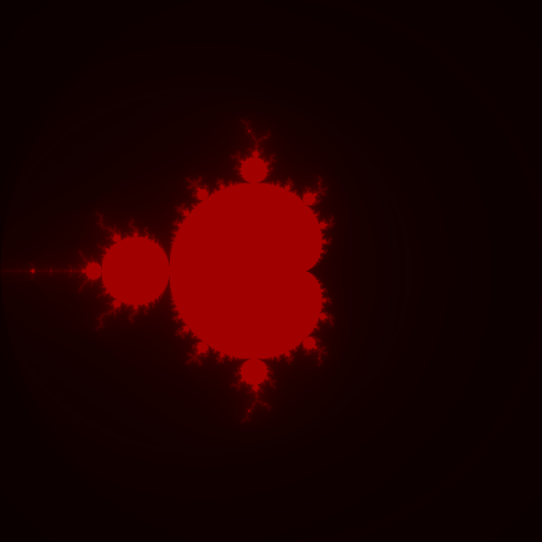

# Множество Мандельброта

**Автор:** Шкарупин Сергей Иванович

**Группа:** ПИ25_2

**Дисциплина:** Практикум по программированию

**Дата сдачи:** 29.10.2026

## Описание проекта

Программа рисует множество Мандельброта в окне tkinter.
Фигуру можно приближать и рассматривать её отдельные участки.
Начальная область — от -2 до 2 по обеим осям.

## Функциональные возможности

### Основное

- Расчёт точек через действительную и мнимую части числа.
- Отрисовка по строкам с показом процента готовности.

### Дополнительно

- Красная палитра и сглаживание границ.
- Приближение и отдаление мышью, кнопками и с клавиатуры.
- Возврат к начальному виду.

## Пример изображения



## Требования к системе

Нужен Python 3.9 или новее с tkinter.
Программа рассчитана на Windows, Linux и macOS.
Используются только стандартные модули `tkinter` и `math`.

## Установка и запуск

### 1. Скачать проект

```bash
git clone https://github.com/shkarupinsergey/Mnojestvo_Mandelborta.git
cd Mnojestvo_Mandelborta
```

### 2. Создать виртуальное окружение

Папка `venv` добавлена в репозиторий по условию задания.
На другом компьютере окружение нужно пересоздать.

Windows, командная строка cmd:

```bat
python -m venv venv
venv\Scripts\activate.bat
```

В PowerShell вместо последней команды:

```powershell
.\venv\Scripts\Activate.ps1
```

Если активация запрещена, можно воспользоваться cmd.

Linux и macOS:

```bash
python3 -m venv venv
source venv/bin/activate
```

Если tkinter не установлен, в Windows его можно добавить через установщик
Python, выбрав Tcl/Tk. В Ubuntu и Debian нужен пакет `python3-tk`.

### 3. Проверить зависимости и запустить

```bash
python -m pip install -r requirements.txt
python main.py
```

Дополнительных библиотек нет, поэтому pip ничего не устанавливает.

## Управление

| Кнопка или клавиша | Действие |
| --- | --- |
| ЛКМ по картинке | Приблизить выбранную точку |
| ПКМ по картинке | Отдалить выбранную точку |
| «Увеличить», + или = | Приблизить центр изображения |
| «Уменьшить» или - | Отдалить центр изображения |
| «Сброс» или R | Вернуть начальный вид |

Масштаб меняется в два раза. Для клавиш масштаба нужна английская раскладка.
Ширина области ограничена значениями от 0.000001 до 4.

## Структура проекта

```text
Mnojestvo_Mandelborta/
├── main.py
├── README.md
├── requirements.txt
├── .gitignore
├── images/
│   └── mandelbrot.png
└── venv/
```

Весь код находится в `main.py`: две функции для расчёта и цвета, класс окна.
Для такой небольшой программы отдельные папки с кодом не нужны.
В `images` лежит пример результата, в `venv` — виртуальное окружение.

## Пример использования

После запуска дождитесь появления картинки. Нажмите левой кнопкой
на край красной фигуры, чтобы рассмотреть детали. Для возврата нажмите
«Сброс» или R. Пока идёт расчёт, новые строки появляются постепенно.

## Как считается множество

Для точки `c = cx + i * cy` начинаем с `x = 0` и `y = 0`.
На каждом шаге считаем обе новые координаты по старым значениям:

```text
новый x = x² - y² + cx
новый y = 2 * x * y + cy
```

Если `x² + y² > 4`, точка вышла за круг радиуса 2.
Если за 200 шагов выхода нет, точка считается принадлежащей множеству
и закрашивается красным. Это приближение, поэтому при большом увеличении
точность ограничена. Для плавного цвета используется число шагов
с логарифмическим уточнением, а для сглаживания — четыре пробы на пиксель.

Задание взято из лабораторной «3.1 Простая анимация», страница 5.
Выполнены оба дополнительных пункта: цветная отрисовка и зум.
